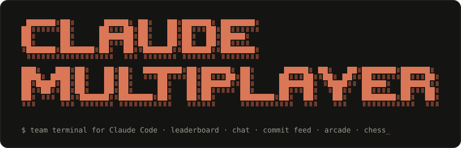
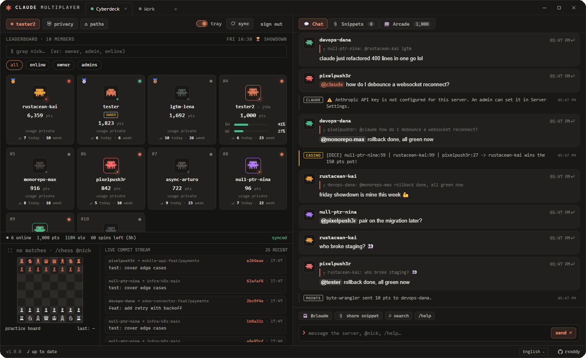
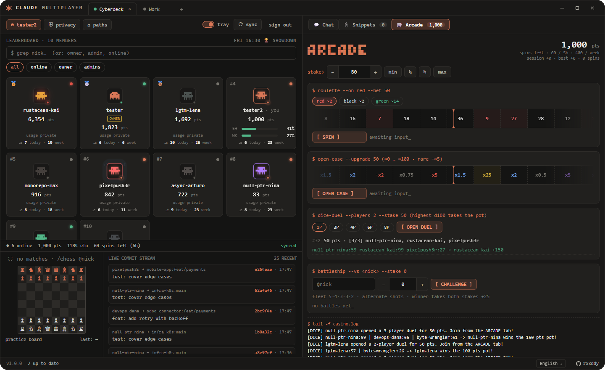
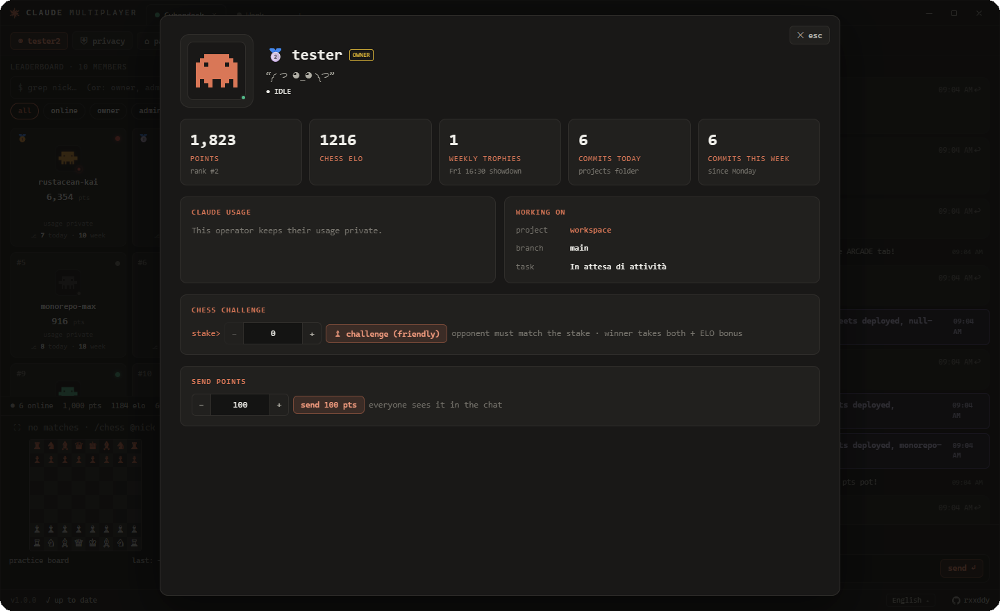
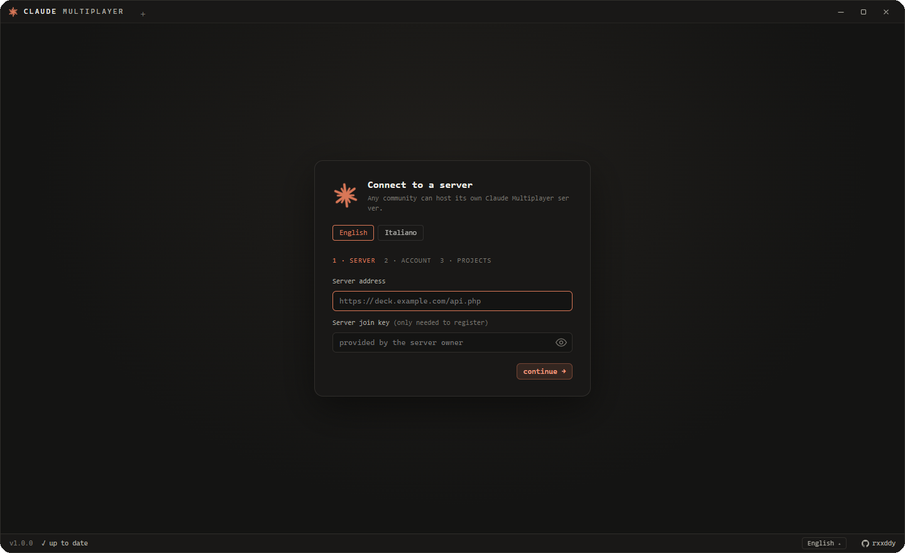

<p align="center">
  
</p>

<p align="center">
  
  
  
  
  
</p>

```text
┌──────────────────────────────────────────────────────────────────────────────┐
│  A multiplayer terminal for people who code with Claude Code.                │
│                                                                              │
│  See who is shipping, how close everyone is to their Claude limits, what     │
│  they are working on — then chat, trade points, play chess and battleship.   │
│  Any community can host its own server: one PHP file + SQLite.               │
└──────────────────────────────────────────────────────────────────────────────┘
```

```text
┌─ official server ────────────────────────────────────────────────────────────┐
│                                                                              │
│   $ connect  https://204-216-221-21.sslip.io                                 │
│                                                                              │
│   The original Claude Multiplayer community, run by the author.              │
│   Install the app, press + and paste the address above.                       │
└──────────────────────────────────────────────────────────────────────────────┘
```

<p align="center">
  
</p>

## `$ ls features/`

| | |
|---|---|
| **Leaderboard** | Points, chess ELO, weekly trophies, medals for the top 3. Search by nick or `owner` / `admin` / `online`. |
| **Claude usage** | Live 5-hour and weekly limits (from `claude /usage`) and context fill — also drawn on the tray icon. |
| **Commit counters** | Commits today / this week, counted locally in your projects folder. Nothing but the two numbers leaves your PC. |
| **Live commit feed** | Short hash, branch and message of every new commit, streamed to the server you are on. |
| **What I am working on** | Claude Code writes a 3–5 word topic of your current task; others see it translated into their language. |
| **Chat** | Replies, `@mentions`, `@claude` bot, code snippets, search by text / user / date, history paging. |
| **Points** | Send points to anyone (announced in chat). The owner can grant points silently. |
| **Arcade** | Roulette, loot cases, dice duels for 2–8 players — with spin limits per 5 hours and per week. |
| **Chess** | Server-authoritative rated chess with optional matched stakes, invites, resign, full-screen arena. |
| **Battleship** | Hidden fleets, alternate shots, escrowed stakes, the winner takes both. |
| **Friday showdown** | Every Friday at 16:30 the most commits of the week wins the Crown & Golden Frame. |
| **Many servers** | Browser-like tabs: one app, several communities, separate privacy switches for each. |
| **Languages** | English and Italian UI; system messages are translated per reader. |
| **Tray** | Starts with Windows in the background, close-to-tray, limits on the tray icon. |

<table>
  <tr>
    <td width="50%"></td>
    <td width="50%"></td>
  </tr>
  <tr>
    <td align="center"><sub>arcade: roulette, cases, dice duels, battleship</sub></td>
    <td align="center"><sub>player card: stats, chess challenge, send points</sub></td>
  </tr>
</table>

## `$ cat how-it-works.txt`

```text
  your PC                                        any host (Oracle, Plesk, VPS …)
 ┌───────────────────────────────┐              ┌──────────────────────────────┐
 │  Claude Multiplayer (Tauri)   │   HTTPS/JSON │  api.php                     │
 │                               │ ───────────▶ │   accounts · chat · games    │
 │  ├─ git log   (projects dir)  │  only what   │   points · leaderboard       │
 │  ├─ ~/.claude logs + /usage   │  your privacy│                              │
 │  ├─ focus file (task topic)   │  switches    │  ../private_cyberdeck/       │
 │  └─ Windows Credential Manager│  allow       │   SQLite (WAL), outside www  │
 └───────────────────────────────┘              └──────────────────────────────┘
```

- **The client is the trust boundary.** Everything a server returns is rendered as plain text, under a strict CSP, with minimal Tauri permissions. Servers never ship code or HTML to clients.
- **Privacy per server.** Every tab has its own switches — usage, commit counters, commit feed, current task. Switched-off data is **not sent at all**, not just hidden.
- **Your password stays on your machine.** The app derives a PBKDF2-SHA256 key salted with the server URL and username; the server stores an argon2id hash of that. A server can neither read your password nor replay it elsewhere.
- **Saved logins.** Servers have no password reset, so after you sign in or register the app keeps the password in **Windows Credential Manager** (`claude-cyberdeck` entries) and offers *use saved password* on the sign-in screen. Session tokens live there too — never in plain files.
- **Signed updates only**, from GitHub Releases (minisign).

## `$ ./install`

1. Download the latest installer from [Releases](https://github.com/rxxddy/claude-multiplayer/releases) and run it.
2. Pick a language, enter a server address (and its join key, if it has one).
3. Sign in or register.
4. Choose the folder where you keep your projects — only git repositories inside it are counted.

<p align="center">
  
</p>

The app starts with Windows in the tray. You can re-add it to startup, change the projects folder and the language under **paths**.

## `$ ./host-a-server`

A server is one file — [`api.php`](api.php) — and an SQLite database it creates itself one level **above** the web root (`../private_cyberdeck/`). Needs PHP 8.1+ with `pdo_sqlite`, `sodium`, `mbstring`, `curl`, and HTTPS.

Set three lines at the top of `api.php` (or the matching environment variables):

```php
const SERVER_NAME = 'My Community';   // DECK_SERVER_NAME — shown in everyone's tab
const JOIN_KEY    = 'secret-key';      // DECK_JOIN_KEY    — needed to register ('' = open)
const SETUP_TOKEN = 'long-random';     // DECK_SETUP_TOKEN — protects the first account (= owner)
```

Register first, using the setup token: you become the owner. Name, join key, games and limits can be changed later in the app under **server settings**.

<details>
<summary><b>▸ Oracle Cloud Always Free</b> — a free VM, set up with one command</summary>

<br>

1. Sign up at [oracle.com/cloud/free](https://www.oracle.com/cloud/free/). Pick an EU home region (e.g. *Italy Northwest (Milan)*). Do **not** upgrade to Pay As You Go.
2. **Compute → Create instance**: image **Ubuntu 24.04**, shape **VM.Standard.A1.Flex** (1 OCPU / 6 GB) or **VM.Standard.E2.1.Micro** — both *Always Free-eligible*. Create a new VCN with a **public subnet**, download the SSH private key.
3. Instance → VNIC → **IP administration** → edit the private IP → *Ephemeral public IP*.
4. Subnet → **Default Security List** → add ingress rule: source `0.0.0.0/0`, TCP, **destination** ports `80,443`.
5. From your PC:

   ```bash
   scp -i key.pem api.php deploy/oracle-setup.sh deploy/landing.html ubuntu@<ip>:~/
   ssh -i key.pem ubuntu@<ip>
   sudo bash oracle-setup.sh "" "My Community" "my-join-key"
   ```

   Empty domain = free `<ip>.sslip.io` address with HTTPS. The script prints the address and the **setup token**.

It installs PHP-FPM + SQLite, Caddy with automatic HTTPS, a landing page, a firewall (22/80/443), SSH hardening, automatic security updates, a rotated error log and nightly database backups (14 days). Re-running it updates `api.php` and keeps the data. Details: [`deploy/README.md`](deploy/README.md).

</details>

<details>
<summary><b>▸ Plesk / shared hosting</b></summary>

<br>

1. **PHP settings**: PHP 8.3 (FPM), extensions `pdo_sqlite`, `sodium`, `mbstring`, `curl` on; `expose_php` off.
2. **SSL/TLS**: issue a Let's Encrypt certificate, redirect HTTP → HTTPS.
3. Edit the three constants in `api.php` and upload it to `httpdocs/`. The database appears in `private_cyberdeck/` next to `httpdocs`, unreachable from the web.
4. In the app add `https://your-domain` (the app appends `/api.php`) and register with the setup token.

</details>

```text
 security checklist
 ──────────────────
 [x] HTTPS only (plain http is accepted for localhost / LAN only)
 [x] setup token set before the server is public
 [x] database outside the web root
 [x] auth rate limit: 12 sign-ins / 5 min per IP; per-user action limits
 [x] prepared statements everywhere; atomic, race-free point transfers
 [x] Anthropic key (for @claude) encrypted at rest — and billed to its owner
```

## `$ make dev`

```bash
npm install
cp php-local.example.ini php-local.ini          # point extension_dir to your PHP
php -c php-local.ini -S 127.0.0.1:8090 api.php  # local server
npx tauri dev                                   # app (first Rust build takes a while)
```

| command | |
|---|---|
| `npm run lint` · `npm run format` | ESLint + Prettier |
| `python tools/test_api.py <url> <db>` | server regression suite (124 checks: chess perft, races, casino EV) |
| `python tools/simulate_room.py http://127.0.0.1:8090/api.php` | eight demo members that chat, commit, play and trade points |

Requirements: Node.js LTS, Rust, Visual Studio Build Tools (C++ + Windows 11 SDK), PHP 8.3. Server API reference: [`docs/API.md`](docs/API.md).

**Adding a language:** copy `src/i18n/locales/en.js` to `<code>.js`, translate the values, register it in `src/i18n/index.js`. Missing keys fall back to English.

## `$ cat LICENSE`

MIT © [rxxddy](https://github.com/rxxddy)

<p align="center"><sub><code>made for teams who live in the terminal_</code></sub></p>
